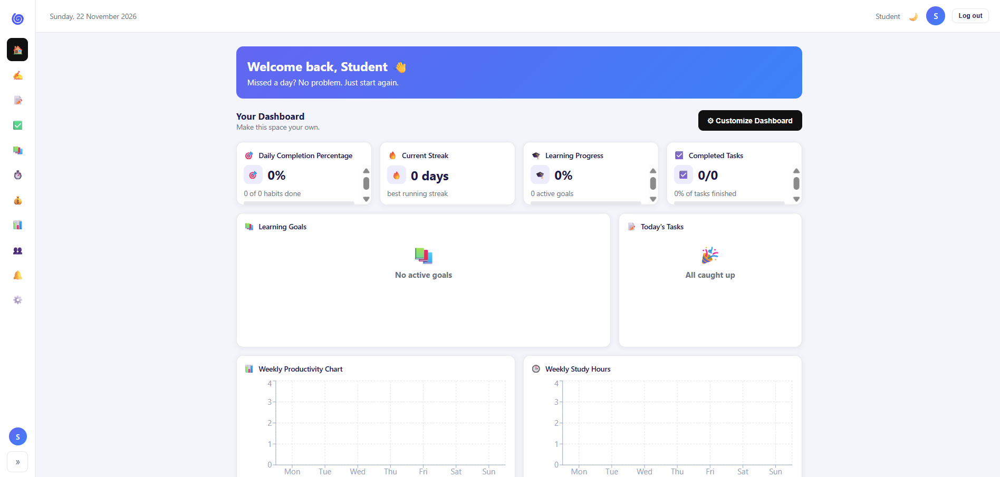
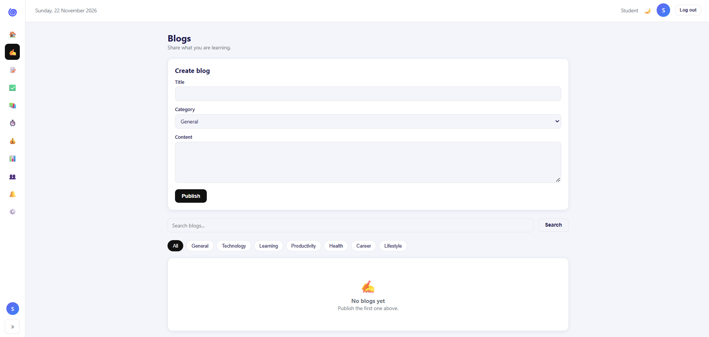

# HabitFlow

A full-stack blogging and productivity app built with the MERN stack. Users can register, write and manage blog posts with categories and search, view their own dashboard, and manage their profile.

**Live demo:** https://habitflow-eight-green.vercel.app/
**API:** https://habitflow-api-5xjj.onrender.com/

> The free API host sleeps when idle, so the first request after a pause can take up to a minute.




## Features

- **Authentication:** register, login, JWT sessions, bcrypt password hashing, password change that signs out other devices
- **Blog CRUD:** create, read, update and delete posts, with author-only edit and delete
- **Search, categories and pagination** combined in a single query
- **My Blogs:** a private page showing only the logged-in user's posts, with stats
- **Customizable dashboard:** drag, drop and resize widgets with saved layouts and presets
- **Profile:** edit name and college, upload a profile picture, change password
- **UI:** responsive layout, slim expandable sidebar, light/dark mode, Black & White style

## Tech stack

| Layer | Technology |
|---|---|
| Frontend | React, Vite, React Router, Recharts, react-grid-layout |
| Backend | Node.js, Express, JWT, bcryptjs, Helmet, express-rate-limit |
| Database | MongoDB Atlas, Mongoose |
| Hosting | Vercel (frontend), Render (backend) |

## Architecture

```
backend/src
  routes/        URL to controller mapping
  controllers/   read the request, call a service, send the response
  services/      business logic
  models/        Mongoose schemas
  middleware/    auth, validation, rate limiting, error handling
```

Request flow: route, validation, controller, service, model, JSON response. Every error goes through one central handler.

## Security

- Passwords are stored only as bcrypt hashes and are never returned by the API
- JWTs are signed, expire, and are rejected if issued before a password change
- The author of a blog always comes from the verified token, never from the request body
- Login and registration are rate limited, and Helmet sets secure headers
- All input is validated on the server, and search input is escaped
- CORS only allows the configured frontend origin

## Run locally

Requires Node 18+ and a MongoDB Atlas database.

```bash
git clone https://github.com/Praveenkaarthikeyan/habitflow
cd habitflow

# Backend
cd backend
npm install
cp .env.example .env     # then fill in the values
npm run dev

# Frontend (second terminal)
cd frontend
npm install
cp .env.example .env
npm run dev
```

Open http://localhost:5173.

### Environment variables

**backend/.env**

| Name | Description |
|---|---|
| `PORT` | Server port (default 5000) |
| `NODE_ENV` | `development` or `production` |
| `CLIENT_ORIGIN` | Allowed frontend origin(s), comma separated, no trailing slash |
| `MONGODB_URI` | MongoDB connection string |
| `JWT_SECRET` | Long random string (generate with `node -e "console.log(require('crypto').randomBytes(32).toString('hex'))"`) |
| `JWT_EXPIRES_IN` | Token lifetime, for example `7d` |

**frontend/.env**

| Name | Description |
|---|---|
| `VITE_API_URL` | Backend base URL, for example `http://localhost:5000/api` |

## API reference

Private routes need the header `Authorization: Bearer <token>`.

| Method | Endpoint | Access | Description |
|---|---|---|---|
| GET | `/api/health` | Public | Server status |
| POST | `/api/auth/register` | Public | Create an account |
| POST | `/api/auth/login` | Public | Log in, returns a token |
| GET | `/api/auth/me` | Private | Current user |
| PUT | `/api/users/me` | Private | Update name and college |
| PUT | `/api/users/me/password` | Private | Change password |
| GET | `/api/blogs` | Public | List blogs (`page`, `limit`, `search`, `category`) |
| GET | `/api/blogs/categories` | Public | Category list |
| GET | `/api/blogs/mine` | Private | Only my blogs |
| GET | `/api/blogs/mine/stats` | Private | My totals and category counts |
| GET | `/api/blogs/:id` | Public | One blog |
| POST | `/api/blogs` | Private | Create a blog |
| PUT | `/api/blogs/:id` | Owner | Update a blog |
| DELETE | `/api/blogs/:id` | Owner | Delete a blog |

Status codes used: 200, 201, 400 (invalid input), 401 (not logged in), 403 (not the owner), 404, 409 (duplicate email), 429 (rate limited), 500.

## Roadmap

Habits, learning goals, tasks, expenses, friends and notifications exist as UI prototypes and are not connected to the backend yet. Next: MongoDB models with per-user ownership, then statistics and gamification.

## Author

Praveen Kaarthikeyan A , [LinkedIn] https://www.linkedin.com/in/praveen-kaarthikeyan-abaa90381?utm_source=share_via&utm_content=profile&utm_medium=member_android, [GitHub] https://github.com/Praveenkaarthikeyan/